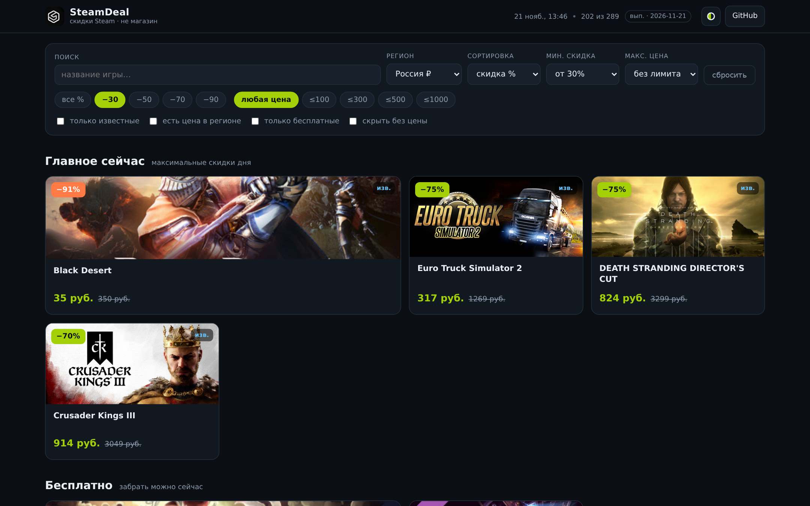

<div align="center">


# SteamDeal

**Чёрно-белая витрина скидок Steam: сотни актуальных специальных предложений с ценами сразу в четырёх регионах**

[](https://stintik-123.github.io/SteamDeal/)

</div>

---

SteamDeal показывает реальные скидки из Steam без визуального шума: чёрно-белый дизайн, крупные обложки и цены, которые видны сразу — до перехода в магазин.



**[Открыть витрину → stintik-123.github.io/SteamDeal](https://stintik-123.github.io/SteamDeal/)**

## Что внутри

- **Сотни специальных предложений** — данные обновляются автоматически каждые 6 часов
- **Цены в четырёх регионах** — RU / KZ / UA / US с правильным форматированием валют
- **Умные фильтры** — размер скидки, поиск, «популярные» и «жирные» (скидки ≥70%), «есть цена в моём регионе»
- **Сортировка** — по скидке, цене или сэкономленным деньгам
- **Топ дня** — самая выгодная сделка плюс блок «бесплатно сейчас»
- **Трейлеры на hover** — наведите курсор на игру, и заиграет её трейлер

Это не магазин: все ссылки ведут в официальный Steam Store. Неофициальный проект, не связан с Valve.

## Как пользоваться

1. Откройте [витрину](https://stintik-123.github.io/SteamDeal/)
2. Отфильтруйте игры по размеру скидки или цене в вашем регионе
3. Нажмите на игру — она откроется в Steam Store

## Обновление данных

Данные обновляются автоматически через GitHub Actions. Запустить вручную: **Actions → Update Steam deals → Run workflow**, либо локально:

```bash
node scripts/update-deals.mjs
```

## Лицензия

[MIT](LICENSE)
